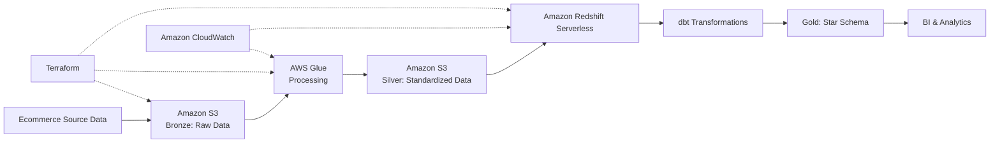

# Ecommerce Data Warehouse on Amazon Redshift Serverless

**An AWS data warehouse project demonstrating modern data engineering practices, dimensional modeling, and Infrastructure as Code.**

[](LICENSE)


## Overview

Ecommerce businesses generate data across orders, customers, products, payments, and shipments. When these sources are analyzed independently, answering basic business questions becomes difficult: How much revenue was actually generated? Which products are driving growth? How has customer behavior changed over time?

This project explores how to address those challenges by designing an AWS-based analytical platform centered on **Amazon Redshift Serverless**.

The architecture follows a layered data processing approach, separating raw data storage, transformation, and analytical consumption. Terraform defines the infrastructure, AWS services support ingestion and processing, and dbt manages SQL-based transformations and data quality.

The objective is not simply to move data into a warehouse. It is to create a reproducible foundation for trustworthy business reporting.

> **Project scope:** This is a portfolio engineering project. Architecture descriptions and implementation status should be read in the context of the repository's actual code and deployment artifacts. It is not presented as a production deployment for a commercial organization.

## Business Context

The platform is designed around two groups of requirements.

**Business stakeholders need:**
- A consistent source of truth for revenue, customer lifetime value, and product performance.
- Historical visibility into customer and product changes.
- Reliable metrics for financial and operational reporting.
- An analytical foundation that can evolve as the business grows.

**Engineering teams need:**
- Reproducible infrastructure across environments.
- Clear separation between ingestion, storage, and transformation.
- Incremental processing to avoid unnecessary recomputation.
- Testable data models with documented business logic.
- Visibility into infrastructure consumption and pipeline execution.

## Architecture

The solution follows a layered data architecture:

**Bronze → Silver → Gold**

| Layer | Responsibility | AWS / Data Technology |
|---|---|---|
| Bronze | Preserve source data and support reprocessing | Amazon S3 |
| Silver | Clean, standardize, and prepare datasets | AWS Glue / SQL |
| Gold | Publish analytics-ready dimensional models | Amazon Redshift Serverless / dbt |

### Architecture at a glance



The architecture separates storage and processing responsibilities so that raw data can be retained independently from analytical transformations.

**Key components**

- **Amazon S3:** Object storage for raw and intermediate datasets.
- **AWS Glue:** Data cataloging and serverless data processing.
- **Amazon Redshift Serverless:** Analytical warehouse for structured reporting workloads.
- **dbt Core:** SQL transformations, model dependencies, testing, and documentation.
- **Terraform:** Infrastructure provisioning and reusable configuration.
- **AWS Step Functions:** Workflow coordination.
- **Amazon CloudWatch:** Operational metrics, logs, and monitoring.

For detailed architecture and implementation information, see the documentation in [`docs/`](docs/).

## Data Modeling

The analytical layer uses a **star schema** designed around ecommerce reporting requirements.

### Fact table

| Model | Grain | Purpose |
|---|---|---|
| `fact_order_items` | One row per order item | Analyze sales, quantities, and order-item performance |

### Dimension tables

| Model | Strategy | Purpose |
|---|---|---|
| `dim_customers` | SCD Type 2 | Preserve customer attribute history |
| `dim_products` | SCD Type 2 | Track product attribute and price changes |
| `dim_date` | Standard date dimension | Support time-series analysis |
| `dim_payment_methods` | Dimension | Analyze payment method distribution |
| `dim_shipment_status` | Dimension | Analyze fulfillment and shipment status |

SCD Type 2 preserves historical versions of selected dimension records, enabling point-in-time analysis rather than overwriting previous values.

The fact table's grain is explicitly defined to prevent accidental duplication when dimensions or other datasets are joined. Financial metrics must also be defined consistently with the business event they represent.

See the data modeling documentation in [`docs/`](docs/).

## Technology Stack

| Layer | Technology | Responsibility |
|---|---|---|
| Cloud | AWS | Managed infrastructure and services |
| Storage | Amazon S3 | Raw and intermediate data storage |
| Processing | AWS Glue | Data preparation and cataloging |
| Warehouse | Amazon Redshift Serverless | Analytical query engine |
| Transformation | dbt Core | SQL modeling and data quality |
| Infrastructure as Code | Terraform | Reproducible infrastructure |
| Orchestration | AWS Step Functions | Workflow coordination |
| Observability | Amazon CloudWatch | Logs, metrics, and alerts |

## Repository Structure

```text
.
├── analytics/
│   ├── dbt/
│   │   ├── models/
│   │   ├── tests/
│   │   └── ...
│   └── sql_examples/
│
├── infra/
│   ├── terraform/
│   │   ├── modules/
│   │   └── environments/
│   │       ├── dev/
│   │       └── prod/
│   └── diagrams/
│
├── docs/
│   └── ...
│
├── LICENSE
└── README.md
```

The repository separates analytical logic from infrastructure definitions. Terraform modules provide reusable building blocks, while environment-specific configuration keeps deployment settings isolated.

## Getting Started

### Prerequisites

- An AWS account with permissions to provision the required services.
- AWS CLI configured with credentials.
- Terraform >= 1.5.0.
- Python >= 3.9.
- dbt Core and the appropriate Redshift adapter.

### 1. Clone the repository

```bash
git clone https://github.com/tuni56/ecommerce-data-warehouse-redshift.git
cd ecommerce-data-warehouse-redshift
```

### 2. Initialize Terraform

```bash
cd infra/terraform/environments/dev
terraform init
```

### 3. Review the infrastructure plan

```bash
terraform validate
terraform plan
```

Review the plan, AWS region, resource names, IAM permissions, and expected costs before applying changes.

### 4. Provision the infrastructure

```bash
terraform apply
```

The resources created depend on the Terraform configuration in the selected environment. Review the actual module definitions before assuming which AWS resources will be provisioned.

### 5. Configure dbt

```bash
cd ../../../../analytics/dbt
cp profiles.yml.example profiles.yml
```

Configure the connection profile with the appropriate Redshift endpoint, database, schema, and authentication settings.

Do not commit credentials or secrets to the repository.

### 6. Install dependencies and execute models

```bash
dbt deps
dbt debug
dbt run --target dev
dbt test
```

### 7. Validate the analytical data

For example, once the corresponding model and database objects are available:

```sql
SELECT COUNT(*)
FROM fact_order_items;
```

## Engineering Practices

### Infrastructure as Code

Terraform is used to define cloud infrastructure declaratively.

The design supports:
- Reusable infrastructure modules.
- Environment-specific configuration.
- Consistent resource naming and tagging.
- Reviewable infrastructure changes through version control.

### Data Quality

Data quality is treated as part of the transformation process, not as a final reporting step.

Relevant validation patterns include:
- Primary-key uniqueness.
- Not-null constraints.
- Referential integrity.
- Source-to-target reconciliation.
- Data freshness checks.

dbt tests provide a framework for expressing and validating these expectations.

### Incremental Processing

Incremental models reduce the need to rebuild entire datasets when only a subset of records has changed.

The incremental strategy must account for late-arriving records, updates, historical corrections, and the selected model's unique key.

### Dimensional Modeling

The star schema separates measurable business events from descriptive attributes.

Defining the grain of each fact table is essential to prevent double-counting and to maintain consistent business metrics.

### Cost Management

Serverless infrastructure reduces some operational responsibilities, but it does not automatically guarantee lower costs.

The cost model should account for:
- Redshift Serverless compute consumption (RPU-hours).
- Redshift storage.
- S3 storage, requests, and data transfer.
- Glue job execution and catalog usage.
- Step Functions state transitions.
- CloudWatch logs, metrics, and retention.
- Networking and supporting AWS services.

Cost optimization should be based on measured workload behavior, not assumptions about the word *serverless*.

## Sample Analytics Queries

### Monthly Revenue Trend

```sql
SELECT
    d.year_month,
    SUM(f.total_amount) AS revenue
FROM fact_order_items AS f
JOIN dim_date AS d
    ON f.order_date_key = d.date_key
GROUP BY d.year_month
ORDER BY d.year_month;
```

### Top Products by Revenue

```sql
SELECT
    p.product_name,
    SUM(f.quantity) AS units_sold,
    SUM(f.total_amount) AS revenue
FROM fact_order_items AS f
JOIN dim_products AS p
    ON f.product_key = p.product_key
WHERE p.is_current = TRUE
GROUP BY p.product_name
ORDER BY revenue DESC
LIMIT 10;
```

These examples assume the referenced columns and models exist in the deployed schema. Revenue definitions should be aligned with the business rules used by the source system.

## Architecture Decisions

This project involves trade-offs between operational complexity, analytical flexibility, performance, and cost.

The main design decisions include:

| Decision | Rationale |
|---|---|
| Redshift Serverless over provisioned Redshift | Avoid initial cluster capacity management while workload patterns are still being evaluated |
| Star schema over Data Vault | Prioritize straightforward analytical consumption and BI compatibility |
| SCD Type 2 dimensions | Preserve historical changes for point-in-time analysis |
| AWS Glue over self-managed processing infrastructure | Reduce infrastructure management for the expected processing workload |
| S3 as a separate storage layer | Decouple raw data retention from warehouse transformations |

These decisions are contextual, not universal recommendations. Different workload sizes, concurrency patterns, latency objectives, and cost constraints can lead to different choices.

See [`docs/`](docs/) for supporting architecture documentation and decision records.

## Monitoring and Observability

The architecture uses Amazon CloudWatch as the central monitoring service.

Relevant monitoring areas include:

- **Redshift:** Query performance, compute consumption, and workload behavior.
- **AWS Glue:** Job execution status, duration, and processing metrics.
- **Step Functions:** Workflow execution status and failures.
- **Data quality:** dbt test results and data freshness.
- **Cost:** AWS Budgets and service-level cost monitoring.

Operational metrics should be tied to explicit expectations, such as pipeline completion time and data freshness.

## Development Workflow

The repository follows a GitFlow-inspired branching strategy:

| Branch | Purpose |
|---|---|
| `main` | Stable, reviewed code |
| `develop` | Integration branch |
| `feature/*` | Individual feature development |
| `hotfix/*` | Urgent corrections |

### Contribution process

1. Create a feature branch from `develop`.
2. Implement the change.
3. Validate Terraform and run relevant dbt tests.
4. Submit a pull request with context and validation results.
5. Merge into `develop` after review.
6. Promote reviewed releases to `main`.

## Roadmap

Planned improvements:

- [ ] Terraform and dbt CI/CD with GitHub Actions.
- [ ] Expanded incremental dbt models and late-arriving data handling.
- [ ] Automated data quality and freshness reporting.
- [ ] Real-time ingestion evaluation.
- [ ] ML use cases, such as customer churn prediction.
- [ ] Cross-region disaster recovery strategy.

Roadmap items are future work, not claims about existing functionality.

## Cost Estimation

Actual costs depend on AWS region, compute configuration, storage volume, query patterns, execution frequency, and data transfer.

A meaningful estimate should be built from the deployed configuration using the [AWS Pricing Calculator](https://calculator.aws/).

Avoid treating illustrative figures as a guaranteed monthly bill. In particular, Redshift Serverless compute consumption can dominate costs when the workgroup is active for extended periods.

## License

This project is licensed under the MIT License. See [`LICENSE`](LICENSE) for details.

## Author

**Rocio Baigorria**

Data Engineering | AWS | Cloud Data Platforms

- [GitHub](https://github.com/tuni56)
- [LinkedIn](https://www.linkedin.com/in/rociobaigorria)

---

This repository is an independent portfolio project and is not affiliated with or endorsed by Amazon Web Services or any commercial organization.
[GitHub](https://github.com/<your-username>) | [LinkedIn](https://linkedin.com/in/<your-profile>)

---

