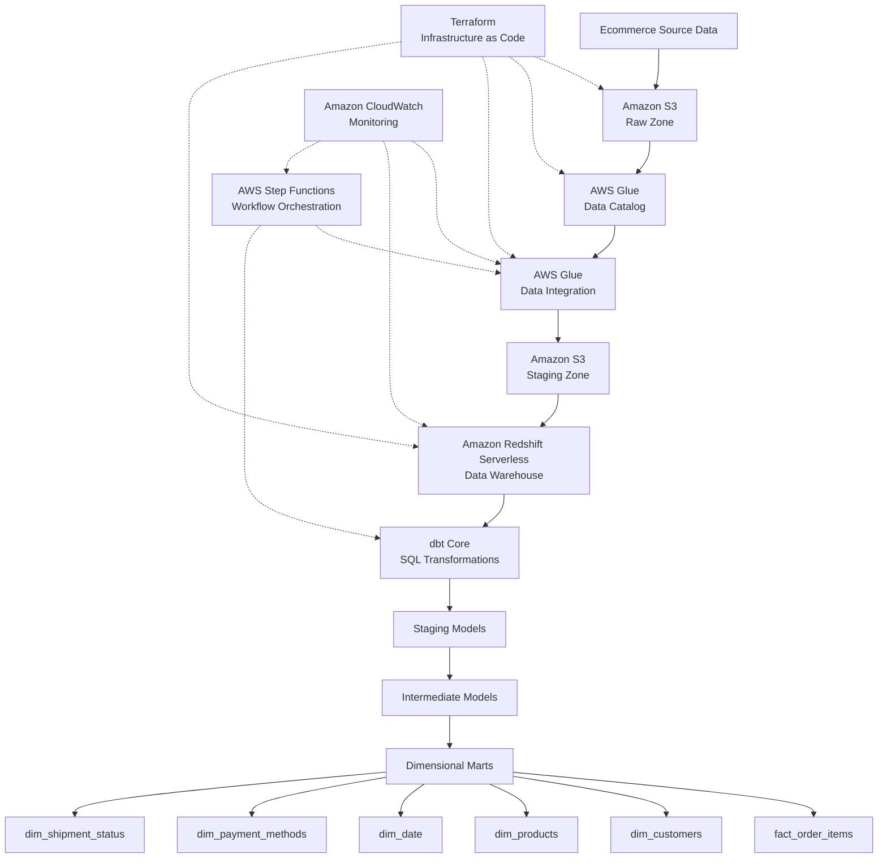
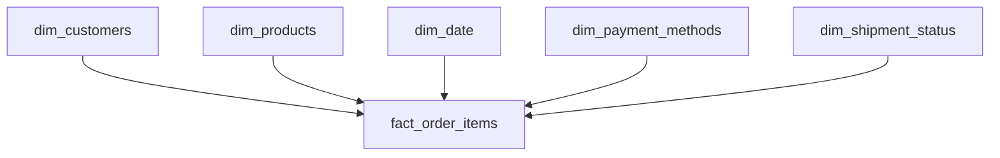

# Architecture Diagram — Ecommerce Data Warehouse on AWS

## 1. High-Level Architecture

The following diagram illustrates the logical architecture and the interaction between the AWS services and data transformation tools.

## 2. Data Flow

The data pipeline follows these stages:

| Step | Component | Description |
|---|---|---|
| 1 | Ecommerce Sources | Source datasets are provided to the platform. |
| 2 | Amazon S3 — Raw | Original datasets are stored in the raw zone. |
| 3 | AWS Glue Data Catalog | Source datasets are cataloged and metadata is maintained. |
| 4 | AWS Glue Data Integration | Data preparation and integration workflows are executed. |
| 5 | Amazon S3 — Staging | Prepared datasets are stored before warehouse loading. |
| 6 | Amazon Redshift Serverless | Data is loaded into the analytical warehouse. |
| 7 | dbt Core | SQL transformations build the analytical models. |
| 8 | Dimensional Marts | Fact and dimension tables become available for analytical queries. |

## 3. Warehouse Modeling Layer

The final analytical layer follows a star schema.

The fact table stores order-item measures and foreign keys to the dimensions.

Customer and product dimensions preserve historical changes through Slowly Changing Dimension Type 2 (SCD Type 2).

See [Data Model](data_model.md) for the table definitions, relationships, and grain.

## 4. Infrastructure and Operational Layer

| Component | Responsibility |
|---|---|
| Terraform | Defines and provisions the AWS infrastructure. |
| AWS Step Functions | Coordinates data workflow execution. |
| Amazon CloudWatch | Provides metrics, logs, dashboards, and alarms for operational monitoring. |

These components support the data pipeline without changing the logical responsibilities of the storage, integration, warehouse, and transformation layers.

## 5. Architecture Summary

The architecture separates the platform into four main functional areas:

- **Storage:** Amazon S3.
- **Data integration:** AWS Glue.
- **Analytical processing:** Amazon Redshift Serverless and dbt Core.
- **Infrastructure and operations:** Terraform, AWS Step Functions, and Amazon CloudWatch.
