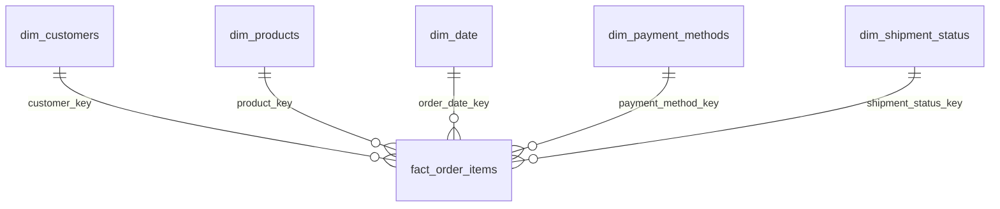

# Data Model — Ecommerce Data Warehouse

## 1. Overview

The ecommerce data warehouse follows a dimensional modeling approach based on a star schema.

The model is designed to support analytical queries across orders, customers, products, payment methods, and shipment status.

It consists of one central fact table and five dimension tables:

- `fact_order_items`
- `dim_customers`
- `dim_products`
- `dim_date`
- `dim_payment_methods`
- `dim_shipment_status`

Customer and product dimensions use Slowly Changing Dimension Type 2 (SCD Type 2) to preserve historical changes.

## 2. Fact Table

### `fact_order_items`

**Grain:** One row per order item.

Each record represents an individual product included in an ecommerce order.

| Column | Data Type | Description |
|---|---|---|
| `order_item_key` | BIGINT | Surrogate primary key |
| `order_key` | VARCHAR | Source order identifier |
| `customer_key` | BIGINT | Foreign key to `dim_customers` |
| `product_key` | BIGINT | Foreign key to `dim_products` |
| `order_date_key` | INTEGER | Foreign key to `dim_date` |
| `payment_method_key` | INTEGER | Foreign key to `dim_payment_methods` |
| `shipment_status_key` | INTEGER | Foreign key to `dim_shipment_status` |
| `quantity` | INTEGER | Number of units ordered |
| `unit_price` | DECIMAL | Price per unit |
| `discount_amount` | DECIMAL | Discount applied to the order item |
| `total_amount` | DECIMAL | Total order-item amount after discount |
| `created_at` | TIMESTAMP | Record creation timestamp |

### Business calculation

The order-item total is calculated as:

```sql
total_amount = (quantity * unit_price) - discount_amount
```

The treatment of taxes, shipping charges, refunds, and currency conversion must be defined according to the source data and business requirements.

## 3. Dimension Tables

### 3.1 `dim_customers`

Contains customer descriptive attributes and historical versions.

| Column | Data Type | Description |
|---|---|---|
| `customer_key` | BIGINT | Surrogate primary key |
| `customer_id` | VARCHAR | Natural/source customer identifier |
| `customer_name` | VARCHAR | Customer name |
| `email` | VARCHAR | Customer email |
| `country` | VARCHAR | Customer country |
| `segment` | VARCHAR | Customer segment |
| `valid_from` | TIMESTAMP | Start of the record's validity |
| `valid_to` | TIMESTAMP | End of the record's validity |
| `is_current` | BOOLEAN | Indicates the current version |

**Historical strategy:** SCD Type 2.

When a tracked customer attribute changes, a new dimension record is created instead of overwriting the previous version.

### 3.2 `dim_products`

Contains product descriptive attributes and historical versions.

| Column | Data Type | Description |
|---|---|---|
| `product_key` | BIGINT | Surrogate primary key |
| `product_id` | VARCHAR | Natural/source product identifier |
| `product_name` | VARCHAR | Product name |
| `category` | VARCHAR | Product category |
| `subcategory` | VARCHAR | Product subcategory |
| `list_price` | DECIMAL | Product list price |
| `valid_from` | TIMESTAMP | Start of the record's validity |
| `valid_to` | TIMESTAMP | End of the record's validity |
| `is_current` | BOOLEAN | Indicates the current version |

**Historical strategy:** SCD Type 2.

Product attribute changes generate new dimension versions, preserving previous values for historical analysis.

### 3.3 `dim_date`

Provides calendar attributes for time-based analysis.

| Column | Data Type | Description |
|---|---|---|
| `date_key` | INTEGER | Date identifier in YYYYMMDD format |
| `date_value` | DATE | Calendar date |
| `year` | INTEGER | Calendar year |
| `quarter` | INTEGER | Calendar quarter |
| `month` | INTEGER | Month number |
| `day_of_week` | INTEGER | Day of the week |
| `month_name` | VARCHAR | Month name |
| `is_weekend` | BOOLEAN | Indicates whether the date is a weekend |

### 3.4 `dim_payment_methods`

Contains payment method reference data.

| Column | Data Type | Description |
|---|---|---|
| `payment_method_key` | INTEGER | Surrogate primary key |
| `payment_method` | VARCHAR | Payment method description |

### 3.5 `dim_shipment_status`

Contains shipment status reference data.

| Column | Data Type | Description |
|---|---|---|
| `shipment_status_key` | INTEGER | Surrogate primary key |
| `shipment_status` | VARCHAR | Shipment status description |

## 4. Entity Relationships

The fact table references all five dimensions through foreign keys.



Each dimension record can be associated with multiple order-item records.

## 5. Slowly Changing Dimensions — Type 2

SCD Type 2 preserves historical changes in customer and product attributes.

When a tracked attribute changes:

1. The existing dimension record is marked as no longer current.
2. Its `valid_to` timestamp is updated.
3. A new record is inserted with a new surrogate key.
4. The new record receives a `valid_from` timestamp.
5. The new record is marked as current.

Example:

| customer_key | customer_id | country | valid_from | valid_to | is_current |
|---:|---|---|---|---|---|
| 101 | C001 | Argentina | 2025-01-01 | 2025-06-30 | FALSE |
| 205 | C001 | United States | 2025-07-01 | 9999-12-31 | TRUE |

This allows historical queries to use the customer attributes that were valid at the time of the order.

## 6. dbt Model Organization

The dbt project follows a layered transformation structure.

| Layer | Example models | Responsibility |
|---|---|---|
| Staging | `stg_orders`, `stg_customers`, `stg_products` | Standardize and prepare source data |
| Intermediate | `int_order_items_enriched`, `int_customers_scd` | Apply business logic and combine datasets |
| Marts | `fact_order_items`, `dim_customers`, `dim_products`, `dim_date`, `dim_payment_methods`, `dim_shipment_status` | Publish analytical models |

The SCD Type 2 implementation must use a consistent strategy for tracking changes and resolving historical dimension versions.

## 7. Data Quality Requirements

The dimensional model should enforce the following quality rules through dbt tests:

- Surrogate primary keys must be unique and not null.
- Required business identifiers must not be null.
- Fact foreign keys must reference valid dimension records.
- Quantity and monetary measures must satisfy their business constraints.
- Each customer natural key must have no more than one current version.
- Each product natural key must have no more than one current version.
- Historical validity intervals must be consistent.
- `total_amount` must reconcile with its business calculation.

## 8. Design Principles

The model follows these principles:

**Surrogate keys:** Dimension tables use warehouse-generated keys to identify individual dimension versions.

**Natural keys:** Source identifiers are retained to identify business entities across source systems.

**Conformed dimensions:** Shared dimensions provide consistent descriptive context for analytical queries.

**Historical preservation:** SCD Type 2 retains customer and product attribute history.

**Defined fact grain:** `fact_order_items` represents one individual order item per row.

## 9. Related Documentation

- [Architecture](architecture.md)
- [Architecture Diagram](architecture-diagram.md)
- [Architectural Decisions](decisions.md)
- [Implementation Guide](implementation-guide.md)

